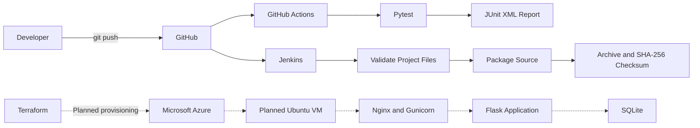

# ReleaseNote

**Automated Software Release Management and Changelog Tracking Using Flask, SQLite, Jenkins, Terraform, and Microsoft Azure**

*Track every release. Automate every deployment.*

B.Tech VII Sem, DevOps (24DC2006), IA-3. ReleaseNote is a Flask web application for managing software releases and changelogs, supported by a DevOps workflow using GitHub, GitHub Actions, Jenkins, Terraform, and Microsoft Azure.

> **Implementation status:** The GitHub Actions workflow successfully ran 78 automated tests with zero failures and zero errors, and uploaded a JUnit XML report as a workflow artifact. The Jenkins `ReleaseNote-CI` pipeline also completed successfully, validating required project files and generating a source archive with a SHA-256 checksum. These are separate workflows. Azure provisioning, remote deployment, and live health verification have not yet been confirmed. Only claim stages supported by actual execution evidence.

## Features

- Dashboard displaying release totals, latest released version and date, status counts, and recent activity.
- Searchable, filterable, sortable, and paginated release history.
- Create, view, edit, and delete software releases.
- Server-side validation and duplicate-version protection.
- Delete confirmation page.
- About page displaying the build ID.
- `/health` JSON endpoint with database status checks.
- Sign-in for management operations and CSRF protection.
- Security headers and responsive, offline-capable user interface.
- Automated tests using Pytest.
- GitHub Actions workflow for automated test execution and report upload.
- Jenkins pipeline for source checkout, project-file validation, and source packaging.
- Terraform configuration for the planned Azure infrastructure.

## Technology Stack

- **Application:** Python 3, Flask 3.0.3, Jinja2
- **Database:** SQLite
- **Application server:** Gunicorn 22
- **Web server and service management:** Nginx, systemd
- **Testing:** Pytest 8.2.2
- **Version control:** Git and GitHub
- **CI workflows:** GitHub Actions and Jenkins Declarative Pipeline
- **Infrastructure as code:** Terraform >= 1.6 and AzureRM provider ~> 4.0
- **Planned hosting:** Ubuntu 22.04 LTS on an Azure virtual machine

## Architecture

See [docs/ARCHITECTURE.md](docs/ARCHITECTURE.md) for the detailed architecture and design.



The GitHub Actions testing workflow and Jenkins packaging pipeline are currently separate. The Azure deployment path shown above represents the intended architecture and is not confirmation of a completed deployment.

## Repository Structure

```text
releasenote-devops/
├── .github/
│   └── workflows/
│       └── python-tests.yml
├── wsgi.py
├── config.py
├── gunicorn.conf.py
├── requirements.txt
├── requirements-dev.txt
├── pytest.ini
├── Jenkinsfile
├── app/
│   └── Flask application, templates, and static assets
├── tests/
│   └── Automated tests
├── terraform/
│   └── Terraform configuration and examples
├── deploy/
│   └── Deployment scripts, service, and Nginx configuration
└── docs/
    ├── ARCHITECTURE.md
    ├── TERRAFORM.md
    ├── JENKINS.md
    ├── REPORT.md
    ├── PRESENTATION.md
    ├── SCREENSHOTS.md
    └── CERTIFICATION.md
```

## Prerequisites

For local development:

- Python 3.10 or later
- Git
- A web browser

For the planned Azure deployment:

- A GitHub account
- A Jenkins environment with the required plugins
- An Azure subscription
- Azure CLI
- Terraform >= 1.6
- An SSH client and SSH key pair

Azure resources may incur charges. Do not provision resources unless you have reviewed the Terraform plan and approved the expected cost.

## 1. Run the Application Locally

### Windows PowerShell

Run these commands from the directory containing the repository and its parent `.venv` environment, adjusting paths if necessary.

```powershell
Set-Location .\releasenote-devops
..\.venv\Scripts\Activate.ps1
$env:APP_ENV = "development"
python -m pip install -r requirements.txt
python -m flask --app wsgi init-db
python -m flask --app wsgi seed-demo
python -m flask --app wsgi run
```

### Linux

```bash
python3 -m venv .venv
source .venv/bin/activate
python -m pip install -r requirements-dev.txt
export APP_ENV=development
python -m flask --app wsgi init-db
python -m flask --app wsgi seed-demo
python -m flask --app wsgi run
```

Open [http://127.0.0.1:5000](http://127.0.0.1:5000).

The application initializes its database schema and adds missing demo versions as configured. Demo seeding is intended to be repeatable and does not overwrite existing versions or user-created records.

A fresh database receives demo releases spanning versions v1.6.0 through v2.5.0.

### Management Authentication

For local development, editing is available without sign-in when no administrator password hash is configured, according to the application's configuration.

To generate a password hash:

```bash
python -m flask --app wsgi hash-password
```

Configure the resulting value using `ADMIN_PASSWORD_HASH` as described in the application's configuration and deployment documentation.

### Resetting a Development Database

**Warning:** This operation deletes records from the specified development database. Never use it on a database containing records you need to keep.

Use the project's documented `reset-demo --yes` command only with `APP_ENV=development` and a verified development database path.

## 2. Run the Automated Tests

Install development dependencies:

```bash
python -m pip install -r requirements-dev.txt
```

Run the test suite:

```bash
python -m pytest -v
```

The tests use isolated temporary databases to avoid modifying real application data.

### Verified GitHub Actions Results

The repository includes a workflow at `.github/workflows/python-tests.yml`.

The workflow runs on pushes and pull requests targeting `main`, and supports manual execution through GitHub Actions.

**Verified workflow result:**

| Metric | Result |
|---|---:|
| Tests executed | 78 |
| Failures | 0 |
| Errors | 0 |
| Skipped | 0 |
| Outcome | Success |

The workflow generates a JUnit XML report at `reports/junit.xml` and uploads it as the `releasenote-test-report` artifact. The artifact is configured to be retained for 14 days.

View the workflow runs: [GitHub Actions](https://github.com/azcruze/releasenote-devops/actions).

The results above describe the verified workflow run; rerun the workflow after subsequent code or test changes to obtain updated results.

## 3. Jenkins CI Pipeline

The Jenkins job is named `ReleaseNote-CI`.

The verified pipeline performs the following stages:

1. **Checkout:** Retrieves the source code from the GitHub `main` branch.
2. **Verify Environment:** Checks the availability and versions of essential command-line tools.
3. **Validate Project Files:** Confirms the presence of required project files and directories.
4. **Package Source:** Creates a compressed source archive and generates a SHA-256 checksum.
5. **Archive Artifacts:** Stores the generated files as Jenkins build artifacts.

The successful build produced:

- `releasenote-source.tar.gz`
- `SHA256SUMS`

These artifacts provide a packaged source snapshot and its checksum for integrity verification.

**Important:** The current verified Jenkins pipeline validates and packages the project. It does not establish that Jenkins runs the 78 Python tests, deploys the application to Azure, or verifies a live application endpoint.

See [docs/JENKINS.md](docs/JENKINS.md) for the planned Jenkins configuration and deployment workflow.

## 4. Planned Azure Provisioning with Terraform

**Status: Not yet verified as executed.** This section documents the intended deployment procedure. Azure resources may incur charges.

Configuration details, authentication, Terraform state management, and variable requirements are documented in [docs/TERRAFORM.md](docs/TERRAFORM.md).

The intended process is:

1. Authenticate with Azure CLI.
2. Configure the Azure subscription and Terraform variables.
3. Review the infrastructure configuration.
4. Initialize Terraform and validate the configuration.
5. Review the proposed infrastructure changes.
6. Apply the plan only after reviewing and approving the resources and costs.

Example commands for a properly configured environment:

```bash
az login

export ARM_SUBSCRIPTION_ID="$(az account show --query id -o tsv)"

ssh-keygen -t ed25519 \
  -f ~/.ssh/releasenote_azure \
  -C releasenote

cd terraform

cp terraform.tfvars.example terraform.tfvars

terraform init
terraform fmt -check
terraform validate
terraform plan -out=tfplan
```

Review the plan before applying it:

```bash
terraform show tfplan
terraform apply tfplan
```

Do not apply the plan unless you explicitly approve the resources and expected costs.

After successful provisioning, the Terraform outputs are intended to include values such as `public_ip_address`, `deployment_url`, and `health_url`, depending on the actual configuration.

Provisioning a virtual machine alone does not prove that the Flask application has been deployed or is healthy.

## 5. Planned Application Deployment

The intended deployment architecture uses:

- Ubuntu Linux
- Nginx as the web server
- Gunicorn to serve the Flask application
- systemd to manage the application service
- SQLite for application data
- Jenkins to automate the deployment workflow

The intended deployment process includes securely transferring the application package, configuring the server, restarting the service, and verifying the health endpoint.

The remote deployment and server configuration steps must be executed and tested before they can be reported as completed.

## 6. Health Verification

The application provides a `/health` endpoint intended to report application and database health.

After a real deployment, verify the endpoint using the actual deployment address:

```bash
curl -s http://<server-ip>/health
```

The expected response depends on the application's implementation and configuration. A healthy response should be checked against the application's actual health-response format.

Also verify the service status on the deployed server:

```bash
sudo systemctl is-active releasenote
sudo systemctl is-active nginx
```

These commands are verification instructions, not evidence that a remote deployment has already succeeded.

If HTTPS has not been configured, the site uses plain HTTP. Do not send sensitive credentials over an untrusted connection.

## 7. Security Considerations

- Keep passwords, SSH private keys, cloud credentials, and other secrets out of Git.
- Store deployment credentials in the appropriate Jenkins Credentials configuration.
- Restrict SSH access to approved source IP ranges.
- Use CSRF protection and server-side validation for management operations.
- Configure an administrator password hash before allowing public management access.
- Use HTTPS for production access and enable secure cookie settings when HTTPS is active.
- Protect Terraform state because it may contain sensitive infrastructure information.
- Review deployment permissions and firewall rules before exposing the application publicly.

For the complete design and its limitations, see [docs/ARCHITECTURE.md](docs/ARCHITECTURE.md).

## 8. Troubleshooting

| Problem | Suggested check |
|---|---|
| Terraform requests a subscription ID | Configure `ARM_SUBSCRIPTION_ID` and verify the active Azure subscription. |
| Azure reports `SkuNotAvailable` | Review available VM sizes and regions before changing the configuration. |
| SSH key file not found | Verify `ssh_public_key_path` points to the correct public key. |
| Nginx returns HTTP 502 | Check the application service status and logs. |
| Management requests return HTTP 403 | Check authentication, authorization, and administrator password configuration. |
| Jenkins cannot connect to a server | Verify network rules, SSH credentials, host configuration, and the permitted source IP range. |
| Tests fail in CI | Open the failed GitHub Actions run and inspect the relevant step logs. |
| Jenkins packaging fails | Inspect the Jenkins Console Output and check the checkout, required files, and archive commands. |

See [docs/JENKINS.md](docs/JENKINS.md) and [docs/TERRAFORM.md](docs/TERRAFORM.md) for additional guidance.

## 9. Cleanup and Cost Control

If Azure resources have actually been provisioned, review the Terraform state and resource plan before destroying them.

```bash
cd terraform
terraform plan -destroy
```

Only after reviewing and approving the destruction plan:

```bash
terraform destroy
```

Destroying infrastructure can remove the virtual machine and any application data stored on it. Capture required project evidence and back up important data before proceeding.

Do not delete Terraform state before confirming that resource cleanup has completed successfully. Verify resource removal in the Azure portal or with the appropriate Azure CLI commands.

## 10. Project Evidence and Documentation

Store genuine screenshots and records of completed work in `docs/SCREENSHOTS.md`.

Recommended evidence includes:

- GitHub repository and commit history.
- Successful GitHub Actions workflow run.
- Test summary showing 78 tests with zero failures and errors.
- Downloadable JUnit XML artifact.
- Successful Jenkins build and Console Output.
- Jenkins source archive and SHA-256 checksum artifacts.
- Terraform validation and plan output, if executed.
- Azure resources, deployment logs, and live health response, only if actually completed.

See [docs/REPORT.md](docs/REPORT.md) for the project report and [docs/PRESENTATION.md](docs/PRESENTATION.md) for presentation material.

## Conclusion

ReleaseNote demonstrates a Flask-based software release tracking application supported by automated testing and source packaging workflows. The verified GitHub Actions run executed 78 tests without failures or errors, while Jenkins successfully validated project files and generated a source archive with a SHA-256 checksum.

Terraform-based Azure provisioning and remote deployment form the intended next stage. They should be described as completed only after the resources have been provisioned, the application has been deployed, and the live health endpoint has been verified.
