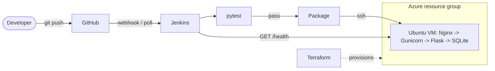

# ReleaseNote

**Automated Software Release Management and Changelog Tracking Using Flask, SQLite, Jenkins, Terraform, and Microsoft Azure**
*Track every release. Automate every deployment.*

B.Tech VII Sem, DevOps (24DC2006), IA-3. A Flask web application that records software releases, plus the complete DevOps path around it: GitHub, Jenkins CI/CD, Terraform-provisioned Azure Linux VM, Nginx + Gunicorn + systemd, health-verified deployment.

> **Status honesty:** the application and its 62 automated tests were run locally during development. Terraform, Azure, Jenkins and webhook steps need *your* credentials and have **not** been executed by the author; verify each with the checks below and record real evidence in `docs/SCREENSHOTS.md`.

## Features
Dashboard (totals, latest released version/date, counts by status, recent activity timeline) · searchable, filterable, sortable, paginated history · create / view / edit / delete releases with server-side validation and duplicate-version protection · delete confirmation page · About page with build ID · `/health` JSON with DB check · sign-in for management, CSRF protection, security headers · responsive, offline-capable UI (no external assets).

## Stack
Python 3, Flask 3.0.3, SQLite, Jinja2, Gunicorn 22, Nginx, systemd · Pytest 8.2.2 · Git/GitHub, Jenkins (declarative pipeline) · Terraform >= 1.6 + AzureRM ~> 4.0 · Ubuntu 22.04 LTS on an Azure VM.

## Architecture
Full diagrams and explanation: [`docs/ARCHITECTURE.md`](docs/ARCHITECTURE.md).



## Repository structure
```
releasenote-devops/
├── wsgi.py                  # entry point (named wsgi.py: the app/ package would shadow app.py)
├── config.py  gunicorn.conf.py  requirements.txt  requirements-dev.txt  pytest.ini
├── Jenkinsfile
├── app/                     # Flask package: routes, models, db, auth, validation, cli, templates/, static/
├── tests/                   # pytest tests, isolated temp databases
├── terraform/               # versions, providers, variables, main, outputs, cloud-init, tfvars example
├── deploy/                  # deploy.sh, rollback.sh, manage.sh, releasenote.service, nginx conf, env example
└── docs/                    # ARCHITECTURE, TERRAFORM, JENKINS, REPORT, PRESENTATION, SCREENSHOTS, CERTIFICATION
```

## Prerequisites
Python 3.10+, Git, an Azure subscription, Azure CLI, Terraform >= 1.6, a GitHub account, a Linux Jenkins machine (see `docs/JENKINS.md`), an SSH client.

## 1. Run locally
**Windows (PowerShell)**
```powershell
Set-Location .\releasenote-devops
..\.venv\Scripts\Activate.ps1
$env:APP_ENV = "development"
python -m pip install -r ..\requirements.txt
python -m flask --app wsgi init-db
python -m flask --app wsgi seed-demo
Set-Location ..
python app.py
```
**Linux**
```bash
python3 -m venv .venv && source .venv/bin/activate
pip install -r requirements-dev.txt
export APP_ENV=development
flask --app wsgi init-db && flask --app wsgi seed-demo
flask --app wsgi run
```
The first app startup creates the schema and inserts any missing versions. Seeding is repeatable; existing versions and user-created records are not overwritten. A fresh database receives 25 entries spanning v1.6.0 through v2.5.0.

Open <http://127.0.0.1:5000>. With no password set, local development allows editing without sign-in. To test sign-in: `flask --app wsgi hash-password`, then set `ADMIN_PASSWORD_HASH` to the output (use single quotes in bash; in PowerShell `$env:ADMIN_PASSWORD_HASH = '<hash>'`).

To reset **only an isolated development database** from the workspace root (this deletes all records in the specified database):
```powershell
$env:APP_ENV = "development"
$env:DATABASE_PATH = Join-Path (Resolve-Path .\releasenote-devops).Path "instance\demo-reset.db"
Push-Location .\releasenote-devops
python -m flask --app wsgi reset-demo --yes
Pop-Location
```
`reset-demo` refuses to run unless `APP_ENV=development`. Do not point `DATABASE_PATH` at a database containing records you need to keep.

## 2. Run the tests
```bash
python -m pytest            # Windows: python -m pytest
```
Tests use a temporary database per test and never touch real application data.

## 3. Provision Azure (Terraform) - creates paid resources
Details, auth and state handling: [`docs/TERRAFORM.md`](docs/TERRAFORM.md).
```bash
az login && export ARM_SUBSCRIPTION_ID="$(az account show --query id -o tsv)"   # PowerShell: $env:ARM_SUBSCRIPTION_ID = (az account show --query id -o tsv)
ssh-keygen -t ed25519 -f ~/.ssh/releasenote_azure -C releasenote
cd terraform
cp terraform.tfvars.example terraform.tfvars        # PowerShell: Copy-Item; then edit ssh_allowed_cidrs
terraform init && terraform fmt -check && terraform validate
terraform plan -out tfplan        # read it
terraform apply tfplan
terraform output
```
Expected: `terraform output` lists `public_ip_address`, `deployment_url`, `health_url`. Right after apply, `curl http://<ip>/health` is **not** expected to work: the app is not deployed until Jenkins runs.

## 4. Jenkins and GitHub
Follow [`docs/JENKINS.md`](docs/JENKINS.md): install plugins, add credentials `releasenote-azure-ssh` and `releasenote-vm-host`, create the Pipeline job from SCM, run once manually, then enable **webhook** (section 6) or **Poll SCM** (section 7).

## 5. First deployment and first-time server settings
Run the Jenkins job. It tests, packages, uploads, runs `deploy.sh`, and verifies the public `/health` shows the commit it built.
Then, once, on the VM (`ssh -i ~/.ssh/releasenote_azure azureuser@<ip>`):
```bash
sudo releasenote-manage hash-password          # prompts; prints a hash
sudo nano /etc/releasenote/releasenote.env     # paste into ADMIN_PASSWORD_HASH='...' (keep quotes)
sudo systemctl restart releasenote
sudo releasenote-manage seed-demo              # safely adds missing demo versions; never deletes user records
```
Until the hash is set the public site is **read-only by design**.

## 6. Verify deployment
```bash
curl -s http://<ip>/health                     # {"status":"ok","database":"ok","build":"<commit>",...}
ssh azureuser@<ip> 'systemctl is-active releasenote nginx; sudo journalctl -u releasenote -n 20 --no-pager'
```
Open `http://<ip>/`, sign in at `/login`, create a release. Make a visible code change, push, watch Jenkins, and confirm `/health` `build` changes to the new commit.

## Troubleshooting
| Problem | Check |
|---|---|
| `terraform plan` asks for subscription | set `ARM_SUBSCRIPTION_ID` |
| `SkuNotAvailable` | pick another `vm_size`/`location` (`az vm list-skus`) |
| validation: key file not found | `ssh_public_key_path` must point to the `.pub` file |
| 502 from Nginx | `sudo systemctl status releasenote`; `journalctl -u releasenote` |
| Site works but writes give 403 | admin hash not configured yet |
| Jenkins SSH timeout | Jenkins public IP missing from `ssh_allowed_cidrs` |
More in `docs/JENKINS.md` section 10.

## Cleanup and cost control
```bash
cd terraform && terraform destroy         # type yes
az group exists --name rg-releasenote-dev    # expect: false
```
Destroy only after capturing all evidence; destroying removes the VM **and the SQLite data**. Delete local `terraform.tfstate` only after a successful destroy.

## Security notes
No secrets in the repo; SSH key and VM host only in Jenkins Credentials; Terraform uses your Azure CLI session; SSH restricted by CIDR; Jenkins not exposed on the VM; site is plain HTTP unless you add TLS (then enable `SESSION_COOKIE_SECURE` and `enable_https`). Full model and limitations: `docs/ARCHITECTURE.md` section 6.
