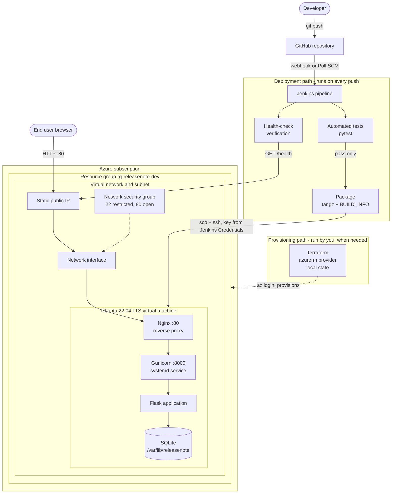
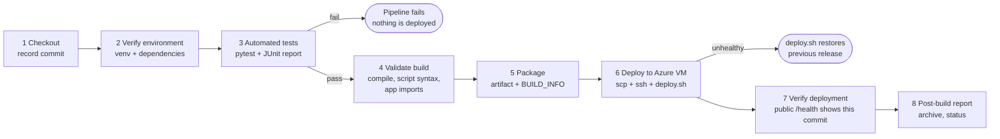

# Architecture

## 1. System architecture

Solid arrows are runtime flows. The dotted Terraform arrow is the separate provisioning path:
Terraform never deploys the application, and Jenkins never creates infrastructure.

## 2. CI/CD pipeline

## 3. Components in plain language

| Component | Role |
|---|---|
| **Flask app** | The web application: pages, validation, CRUD, `/health`. |
| **SQLite** | One-file database; zero setup, ideal for a single-VM demo. Lives outside the code directory so deployments never overwrite it. |
| **Gunicorn** | Production Python server that runs the Flask app (2 workers). Bound to `127.0.0.1` so it is unreachable from outside. |
| **Nginx** | The only public listener (port 80). Forwards requests to Gunicorn. |
| **systemd** | Keeps Gunicorn running, restarts it on failure and at VM reboot, independent of any SSH session. |
| **Terraform** | Creates the Azure resource group, network, firewall rules, public IP and VM from code. |
| **GitHub** | Stores code; a push is the event that starts the pipeline. |
| **Jenkins** | Orchestrates test, package, deploy and verify. Holds the SSH key in Jenkins Credentials. |
| **pytest** | The quality gate. A failing test stops the pipeline before the deploy stage exists in the run. |

## 4. Data flow

1. Developer pushes to `main`; GitHub notifies Jenkins (webhook) or Jenkins notices on its next poll.
2. Jenkins checks out that exact commit, builds a virtualenv, runs pytest.
3. On success it packages `app/`, `wsgi.py`, `config.py`, `deploy/`, `requirements.txt` and a `BUILD_INFO` file containing the commit ID.
4. Jenkins copies the archive to the VM over SSH and runs `deploy/deploy.sh` with `sudo`.
5. `deploy.sh` installs the release into `/opt/releasenote/releases/<build>-<commit>/`, builds that release's virtualenv, initialises the schema (idempotent), backs up the database, switches the `current` symlink, restarts `releasenote.service`, and waits for `/health`.
6. If the new service is not healthy, `deploy.sh` flips the symlink back and restarts the previous release, then exits non-zero.
7. Jenkins polls the public `http://<ip>/health` and requires `status: ok` **and** the new commit ID in `build`.

## 5. What is automated by whom

| Task | Done by |
|---|---|
| Resource group, VNet, subnet, NSG, public IP, NIC, VM, first-boot packages (nginx, python3-venv) | **Terraform** (+ cloud-init) |
| One-time: generate SSH key, `az login`, add Jenkins credentials, set admin password hash | **You** |
| Service user, directories, env file, venv, schema, systemd unit, Nginx site, restart, health wait, rollback | **`deploy/deploy.sh`**, invoked by Jenkins |
| Test, package, upload, verify | **Jenkins** |

## 6. Security model

* **Reading is public; changing data is not.** Management routes require sign-in when `ADMIN_PASSWORD_HASH` (or `ADMIN_PASSWORD`) is set.
* **Production without a password is read-only** (HTTP 403 on write routes). The first deployment therefore never exposes an unauthenticated admin interface. Local development without a password is "open" for convenience only.
* CSRF token on every POST; parameterised SQL; Jinja auto-escaping; strict server-side validation; security headers incl. a same-origin CSP; request size limit; login throttling (5 failures / 5 min per source IP, per worker).
* **Limitations (state them in your viva):** traffic is plain HTTP, so the sign-in password and session cookie cross the network unencrypted. Add TLS (e.g. Let's Encrypt with a DNS name), then set `SESSION_COOKIE_SECURE=true` and `enable_https = true`. There is a single shared admin password, no per-user audit trail, and the throttle is in-memory per Gunicorn worker.
* Secrets: SSH key and VM host only in Jenkins Credentials; app secrets only in `/etc/releasenote/releasenote.env` (root:releasenote, 640); Terraform state stays local and git-ignored.
